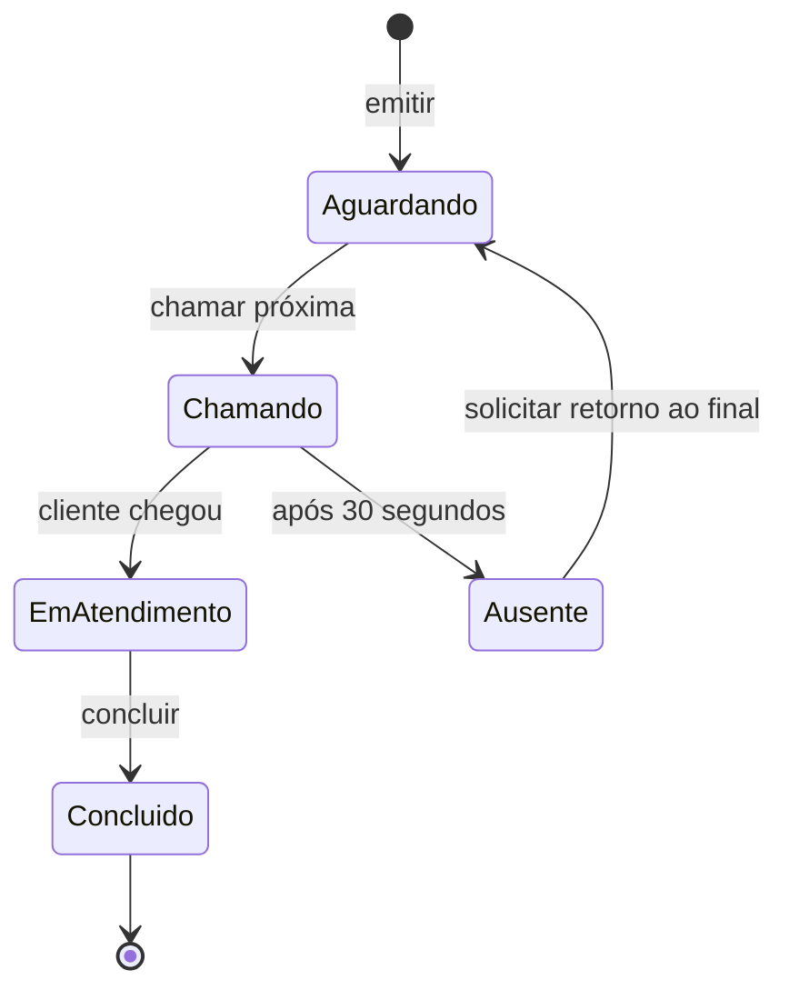

# Como funciona o CorteÁgil

Guia de estudo da versão atual: Angular 22.2.3, Angular Material, componentes pertencentes a NgModules, API Node.js 24, Express e SQLite. O README foi deixado vazio a pedido; as orientações ficam nesta pasta.

## 1. O que existe no sistema

São quatro interfaces conectadas à mesma fila:

| Rota           | Quem usa                       | O que faz                                                             |
| -------------- | ------------------------------ | --------------------------------------------------------------------- |
| `/cliente`     | Cliente no celular             | Retira senha, consulta posição, recebe avisos e solicita retorno      |
| `/funcionario` | Funcionário autenticado        | Chama, confirma presença, conclui, registra ausência e pausa emissões |
| `/painel`      | TV do açougue                  | Exibe senha atual, próximas senhas, prazo e alerta sonoro             |
| `/totem`       | Cliente no equipamento da loja | Retira senha e gera ticket com QR Code para imprimir                  |

`/entrar` é a tela de login da equipe. O sistema atual tem um balcão, identificado como 01, e uma conta administrativa chamada `admin`.

## 2. O que roda no navegador e o que roda no servidor

O Angular roda no navegador de cada celular, TV, totem ou estação do funcionário. Ele apresenta as telas, recebe cliques e mostra os dados recebidos.

O Node.js roda no computador que centraliza o atendimento. O Express recebe as requisições HTTP. As regras da fila são executadas ali e os resultados são salvos em SQLite. Portanto, o celular não precisa instalar Node ou um banco: acessa o endereço do servidor pelo navegador.

Cada navegador tem sua própria instância dos serviços Angular. A consistência entre dispositivos vem do servidor e do banco central, não de uma variável compartilhada entre computadores.

## 3. A sequência que inicia o Angular

1. `src/index.html` contém `<app-root>` e os metadados da página.
2. `src/main.ts` chama `platformBrowserDynamic().bootstrapModule(AppModule)`.
3. `src/app/app.module.ts` declara `AppComponent` e `ShellComponent`, importa os recursos globais e configura as rotas.
4. O template de `AppComponent` contém `<router-outlet />`.
5. O Angular Router escolhe qual tela inserir nesse espaço, de acordo com a URL.

`BrowserModule` fornece os recursos fundamentais para executar a aplicação no navegador. O locale `pt-BR` é registrado para formatar números e datas. A detecção de mudanças usa Zone.js com coalescência de eventos, enquanto o estado principal das telas usa signals.

## 4. O significado de não usar standalone

Cada componente declara `standalone: false`. Isso indica que ele pertence a um NgModule. Por exemplo, `FuncionarioComponent`, `StatCardComponent` e `AtendimentoAtualComponent` são declarados em `FuncionarioModule`.

```typescript
@NgModule({
  declarations: [FuncionarioComponent, StatCardComponent, AtendimentoAtualComponent],
  imports: [SharedModule, RouterModule.forChild([{ path: '', component: FuncionarioComponent }])],
})
export class FuncionarioModule {}
```

- `declarations`: componentes que pertencem ao módulo.
- `imports`: recursos que os templates desse módulo podem utilizar.
- `exports`: recursos que outros módulos podem usar ao importar esse módulo.
- `providers`: configuração de injeção de dependências quando necessária.
- `bootstrap`: componente inicial, configurado no módulo principal.

Um componente deve pertencer a apenas um módulo. Para reaproveitá-lo em outro, exporte-o do módulo de origem e importe esse módulo no destino.

`angular.json` também configura a geração de novos componentes com `standalone: false` e estilo SCSS.

## 5. As responsabilidades das pastas

| Pasta/arquivo             | Responsabilidade                                                 |
| ------------------------- | ---------------------------------------------------------------- |
| `core/models`             | Contratos TypeScript dos dados                                   |
| `core/services`           | HTTP, autenticação, estado da fila e alertas                     |
| `core/guards`             | Verificação de acesso antes de abrir uma rota                    |
| `shared/material`         | Módulos de componentes do Angular Material                       |
| `shared/components`       | Componentes utilizados por mais de uma tela                      |
| `shared/shared.module.ts` | Reexporta Material, formulários, roteamento e componentes comuns |
| `layout`                  | Menu lateral, cabeçalho e rodapé das telas internas              |
| `features`                | Módulos e páginas de cada área funcional                         |
| `server/domain.mjs`       | Regras da fila, independentes da interface HTTP                  |
| `server/index.mjs`        | API, sessão, persistência e eventos em tempo real                |
| `server/setup.mjs`        | Configuração inicial e geração da senha                          |

## 6. Como funcionam as rotas e o carregamento sob demanda

A rota principal de uma funcionalidade usa `loadChildren`:

```typescript
{
  path: 'cliente',
  loadChildren: () => import('./features/cliente/cliente.module')
    .then(m => m.ClienteModule)
}
```

Isso é lazy loading: o código daquela área é carregado quando a rota é acessada. O módulo da funcionalidade configura a rota vazia, que aponta para seu componente de página.

`ShellComponent` envolve cliente e funcionário com menu, cabeçalho e rodapé. Painel de TV, totem e login usam layouts próprios, por isso ficam fora desse shell.

A rota `/funcionario` utiliza `authGuard`. O guard consulta a sessão no servidor; se ela não estiver válida, devolve uma URL de redirecionamento para `/entrar`.

## 7. Componentes e comunicação por propriedades

Componente é uma parte visual com dados e comportamento. O arquivo `.ts` contém a classe; o `.html` define o template; o SCSS define aparência e responsividade. Componentes pequenos podem ter o template no próprio `.ts`.

Exemplo real de composição:

```html
<app-stat-card
  label="Aguardando"
  [value]="fila.state().waiting.length"
  icon="groups"
  tone="cyan"
  note="Clientes na fila agora"
/>
```

`StatCardComponent` recebe os valores por `@Input()`. A página calcula ou obtém os dados e o card os apresenta. O mesmo componente é reutilizado para quatro indicadores.

`QueueListComponent` recebe um array de senhas por `@Input() tickets`. `StatusBadgeComponent` recebe um status e mostra sua tradução. `AtendimentoAtualComponent` concentra os controles do balcão e o temporizador visual.

## 8. Como ler o HTML do Angular

| Expressão                         | Significado no projeto                                        |
| --------------------------------- | ------------------------------------------------------------- | --------------------------------------- |
| `{{ t.label }}`                   | Interpolação: exibe o número da senha                         |
| `[disabled]="fila.busy()"`        | Property binding: altera uma propriedade do botão             |
| `(click)="fila.run('call')"`      | Event binding: executa um método ao clicar                    |
| `[(ngModel)]="service"`           | Two-way binding: mantém campo e variável sincronizados        |
| `[formGroup]="form"`              | Vincula formulário reativo à estrutura definida no TypeScript |
| `@if (...) { ... }`               | Exibe um trecho se a condição for verdadeira                  |
| `@for (t of tickets; track t.id)` | Repete o template, identificando cada item pelo ID            |
| `@empty { ... }`                  | Mensagem alternativa quando a repetição está vazia            |
| `routerLink="/cliente"`           | Navega por uma rota Angular                                   |
| `{{ valor                         | date:'HH:mm' }}`                                              | Pipe: formata o valor para apresentação |

`track t.id` ajuda o Angular a preservar a identidade dos elementos quando a lista muda. Não é responsável pela numeração das senhas; essa regra pertence ao servidor.

## 9. Signals, computed e effect

`signal` armazena um valor reativo. Leia chamando como função e atualize por `.set()`:

```typescript
readonly busy = signal(false);
this.busy.set(true);
```

O template pode usar `[disabled]="busy()"`. Quando o signal muda, o Angular atualiza quem depende dele.

`computed` deriva um valor de outros signals. Em `FilaService`, `remaining` calcula os segundos restantes usando o prazo da senha atual e o relógio corrigido pelo servidor. Em `FuncionarioComponent`, os filtros e contadores também são derivados.

`effect` executa uma reação quando os signals lidos por ele mudam. O cliente observa mudanças do estado da fila e consulta novamente sua senha. O painel observa uma nova chamada para tocar o som.

`untracked` permite executar um trecho dentro da reação sem adicionar novas dependências reativas por acidente.

## 10. Injeção de dependências e serviços

Um serviço com `@Injectable({providedIn: 'root'})` fica disponível globalmente naquela instância da aplicação. `inject(FilaService)` pede ao Angular a instância desse serviço.

| Serviço         | O que faz                                                       |
| --------------- | --------------------------------------------------------------- |
| `ApiService`    | Requisições HTTP com `fetch`, mensagens de erro e `MatSnackBar` |
| `FilaService`   | Estado público da fila, SSE, relógio e ações de atendimento     |
| `AuthService`   | Login, consulta da sessão e logout                              |
| `AlertaService` | Web Audio e notificações do navegador                           |

Centralizar requisições evita repetir a URL da API, o envio do cookie e o tratamento de erros em cada botão.

## 11. O caminho completo do botão Retirar senha

1. O cliente escolhe um serviço ou mantém “Não informado”.
2. O clique chama `ClienteComponent.issue()`.
3. O componente marca `busy` para evitar cliques repetidos durante a requisição.
4. `FilaService.issue()` pede ao `ApiService` um `POST /api/tickets` com serviço e origem.
5. O Express valida a requisição e chama `queue.issue()` dentro de uma transação.
6. O servidor incrementa a sequência, cria ID e token aleatórios e insere a senha em `waiting`.
7. O estado é gravado no SQLite e a transação é confirmada.
8. O servidor envia o novo estado público aos canais SSE conectados.
9. A resposta de emissão devolve o número e o token ao cliente.
10. O navegador salva esse token em `localStorage` e consulta os dados individuais da senha.

A ordem e o número são gerados no servidor. Duas pessoas solicitando ao mesmo tempo não decidem seu próprio número no celular.

## 12. Identificador, número e token

Uma senha tem três identificações com funções diferentes:

- `id`: UUID utilizado internamente e no `track` das listas.
- `label`: número legível, como `A001`, mostrado ao público.
- `token`: segredo aleatório que permite acompanhar e solicitar retorno daquela senha.

O número da senha não é uma senha de login. O token fica fora do estado público enviado ao painel e aos outros clientes.

`origin` indica `app` ou `totem`; ambas as origens compartilham a mesma fila. `order` determina a ordem operacional. `returns` conta quantas vezes a senha retornou após ausência.

## 13. Como o tempo real funciona

O Angular abre `new EventSource('/api/events')`. O servidor mantém essa conexão aberta e envia snapshots da fila quando ocorre uma alteração.

SSE é um canal do servidor para o navegador. Os comandos do navegador para o servidor usam requisições HTTP, como POST. Ao receber um snapshot, `FilaService` atualiza seu signal `state`, e os componentes que leem esse estado são atualizados.

O cliente consulta também `/api/tickets/:token`, pois posição e avisos individuais não aparecem no snapshot público. O backend envia comentários de heartbeat a cada 15 segundos para manter o canal ativo. O `EventSource` tenta reconectar automaticamente se a conexão cair.

O indicador de conexão fica offline enquanto o canal está desconectado, e as operações principais são desabilitadas nas telas.

## 14. Como funciona o atendimento

A fila padrão é FIFO: primeira entrada, primeiro atendimento. O filtro de serviços ajuda a visualização; a chamada continua usando a primeira senha da fila completa.

1. `callNext()` escolhe a primeira senha aguardando e muda seu estado para `called`.
2. O servidor define `deadline = now + 30000`.
3. O painel mostra a senha e pode emitir o som.
4. Quando o cliente chega, `start` muda a situação para `serving` e registra o início.
5. `finish` conclui um atendimento iniciado e registra o término.
6. O balcão é liberado para a próxima chamada.

Só existe um atendimento ativo. O servidor rejeita outra chamada enquanto o atual não for concluído ou marcado como ausente.



## 15. O prazo de 30 segundos e a ausência

O front mostra a contagem regressiva, mas a regra é verificada no Node. Mesmo uma requisição manual tentando marcar ausência antes do prazo recebe erro.

Ao clicar em Chamar de novo, o sistema repete a chamada e reinicia os 30 segundos. Quando o prazo termina, o funcionário pode marcar Ausente; o sistema não marca sozinho.

A senha ausente recebe um aviso e pode solicitar retorno. O retorno mantém o número e move a senha ao final da fila, com uma marcação visual. Isso é a penalização de prioridade adotada nesta versão.

## 16. Posição, avisos e estimativas

A quantidade de senhas à frente conta quem aguarda antes do cliente mais um atendimento ativo, quando existe. Por exemplo: se `A001` está no balcão e `A002`, `A003` aguardam, `A003` tem duas senhas à frente.

O servidor registra um aviso quando há duas à frente e outro quando há uma. Cada limiar é enviado uma vez por ciclo de retorno. Chamada, ausência, retorno e conclusão também geram eventos. Os últimos 20 avisos por senha são mantidos no banco.

O tempo inicial estimado é 4 minutos por senha. Depois de haver atendimentos concluídos no dia, o cálculo usa os últimos 20 registros concluídos com início, arredondados para minutos, com mínimo de 1 minuto. A estimativa é quantidade à frente multiplicada pela média. O tempo de atendimento para essa média começa na confirmação da chegada, não na chamada.

Os indicadores diários usam o fuso `America/Sao_Paulo`. A contagem de ausentes mostra as senhas que permanecem nesse estado, enquanto aguardando mostra a fila atual.

## 17. Login e proteção da equipe

`npm run setup` cria `.env` e gera uma senha aleatória. O login usa usuário `admin` e essa senha. O servidor faz a verificação usando scrypt e comparação de tempo constante.

Se o login é aceito, o servidor cria uma sessão aleatória e envia um cookie HttpOnly com SameSite. O navegador envia o cookie nas próximas requisições da mesma origem. As sessões duram 8 horas e ficam em memória: reiniciar o servidor exige fazer login novamente, mas preserva a fila.

O `authGuard` protege a navegação Angular. A função `auth` no Express valida as operações administrativas, inclusive se alguém tentar chamar a API diretamente. A senha não fica gravada no código Angular.

O `.env` contém a senha configurada em texto para uso local; ele precisa ser protegido no computador servidor e está excluído do Git. Não há cadastro individual de funcionários ou recuperação de senha por e-mail nesta versão.

## 18. Onde o SQLite guarda os dados

O arquivo padrão é `data/corte-agil.sqlite`. SQLite é um banco em arquivo; não precisa instalar um serviço MySQL separado.

Esta versão tem uma tabela `queue_state`, com uma linha cujo conteúdo é um JSON com sequência, tickets, auditoria e pausa. É uma estrutura compacta para estudo e piloto local.

Cada alteração segue: `BEGIN IMMEDIATE` → leitura → regra → gravação → `COMMIT`. Em caso de erro antes da conclusão, há `ROLLBACK`. O banco usa WAL e `synchronous=FULL` para consistência e recuperação. A emissão da senha e o avanço da sequência fazem parte da mesma transação.

O modelo atual suporta uma instância do servidor para esse banco. Para operar múltiplas instâncias com sessões e eventos compartilhados ou crescer bastante, a arquitetura precisa evoluir.

Para backup simples, pare o servidor e copie toda a pasta `data`. Para restaurar, mantenha o servidor parado durante a substituição. Não existe backup automático implementado.

## 19. Totem, QR Code e impressão

O totem chama o mesmo endpoint de emissão, usando `origin: 'totem'`. Depois cria um endereço com o token no fragmento, como `/cliente#senha=...`, e usa a biblioteca `qrcode` para gerar a imagem localmente.

O celular lê o QR e abre o acompanhamento da senha. A página salva o token no `localStorage`, para reencontrá-lo depois de atualizar. No totem, a ação Próximo cliente limpa a tela do ticket; ela não apaga a senha da fila.

O endereço do QR usa `location.origin`. Portanto, abra o totem pelo IP ou nome do servidor acessível aos celulares. Se você abrir em `localhost`, o QR apontará para localhost, que em outro dispositivo significa o próprio dispositivo.

A impressão usa `window.print()` e uma seção `@media print` que mostra apenas o ticket. O papel está configurado para 80 mm. A impressão precisa ser validada na impressora real e não é silenciosa/ESC-POS.

## 20. Painel e áudio

O painel lê a mesma fila e exibe a senha ativa e até três seguintes. Ao observar um novo `calledAt`, o componente pede ao `AlertaService` para tocar o alerta.

Web Audio sintetiza três tons; não baixa um arquivo de áudio da internet. O botão Ativar som libera o áudio por interação do usuário, conforme a política de autoplay do navegador. A ação Tela cheia usa a API Fullscreen, quando disponível.

## 21. Notificações do celular

Os avisos na página funcionam enquanto o cliente a mantém aberta e conectada. A opção Ativar avisos no navegador solicita permissão para notificações do sistema operacional.

Essas notificações dependem do navegador, da permissão e de um contexto seguro. HTTP por IP local costuma não ser seguro para esse recurso. Não há Service Worker/Web Push para garantir avisos com página fechada ou celular bloqueado. O histórico e o estado são recuperados ao voltar para a página.

## 22. O tema cyan do Angular Material

Em `src/styles.scss`, a configuração usa a paleta oficial:

```scss
@use '@angular/material' as mat;

html {
  color-scheme: light;
  @include mat.theme(
    (
      color: (
        primary: mat.$cyan-palette,
        tertiary: mat.$orange-palette,
      ),
      typography: 'Segoe UI',
      density: 0,
    )
  );
}
```

`primary` controla a cor principal. `tertiary` é a paleta complementar. `typography` define a família de fonte e `density` ajusta o espaçamento dos componentes Material.

O Material gera tokens, como `--mat-sys-primary` e `--mat-sys-on-primary`. O projeto usa `--accent: var(--mat-sys-primary)` para conectar os elementos personalizados ao tema. O par on-primary é a cor do conteúdo desenhado sobre o fundo primary.

O tema é claro nas áreas de operação e cliente; login e TV têm superfícies escuras cyan. Fundos, bordas, destaques e favicon seguem essa identidade. As cores de espera e ausência mantêm seus significados operacionais. A impressão permanece em preto e branco.

O SCSS é compilado pelo Angular para CSS. Alterar o código requer recompilar a versão de produção. No desenvolvimento, `ng serve` acompanha as alterações automaticamente.

## 23. Como os componentes Material chegam aos templates

`MaterialModule` importa e exporta os módulos de botões, cards, campos, inputs, select, ícones, avisos, tooltips e barra de progresso.

`SharedModule` reexporta `MaterialModule`, `CommonModule`, `FormsModule`, `ReactiveFormsModule` e `RouterModule`, além dos componentes comuns. Um módulo de funcionalidade importa `SharedModule` para usar esses recursos.

Exemplos de elementos reais: `<mat-card>`, `<mat-form-field>`, `<mat-select>`, `<mat-icon>`, `mat-flat-button` e `<mat-progress-bar>`. Os ícones usam uma fonte empacotada localmente.

## 24. Como os comandos de execução se relacionam

```bash
npm ci
npm run setup
npm run build
npm start
```

- `npm ci`: instala as versões registradas em `package-lock.json`.
- `setup`: cria `.env` se ele ainda não existir.
- `build`: compila Angular e gera `dist/corte-agil/browser`.
- `start`: inicia Express, API e entrega dos arquivos compilados na porta 3000.

Requer Node 24.15 ou superior da linha 24. Acesse `http://localhost:3000`. No Codespaces, abra a porta 3000 na aba PORTS; mantenha o acesso privado ao servidor e aos dados operacionais.

Para desenvolver, deixe `npm start` em um terminal e rode `npm run dev` em outro. Abra a porta 4200. `proxy.conf.json` encaminha `/api` do servidor Angular para o Node na porta 3000.

Depois de alterar o código, para atualizar a versão servida por Express, execute `npm run build`. Se você alterar o código Node, reinicie o servidor.

## 25. O que vai para o GitHub

Vão código-fonte, configuração do projeto, lockfile e documentos. `.gitignore` exclui `node_modules`, `dist`, `.angular`, `.env`, banco de dados e logs. A conta administrativa e os dados operacionais são criados localmente.

O Git guarda versões do código. O SQLite guarda a fila da loja. Atualizar o repositório não é o mesmo que apagar ou reiniciar o banco.

## 26. Testes e próximos estudos

`npm test` executa testes das regras e da API. `npm run build` verifica a compilação TypeScript, templates Angular e SCSS. `npm run check` executa ambos.

Os testes cobrem senha única, mesma fila entre origens, avisos, prazo de ausência, retorno ao final, pausa, login, concorrência de chamadas, SSE e recuperação após reinício. Não substituem ensaio de carga ou homologação de impressora.

Ordem recomendada de leitura para estudar o código:

1. `core/models/fila.model.ts`: identifique os campos da senha.
2. `features/cliente/cliente.component.html` e `.ts`: siga o clique de emissão.
3. `core/services/fila.service.ts` e `api.service.ts`: veja a requisição.
4. `server/index.mjs` e `server/domain.mjs`: encontre a rota e a regra.
5. `features/funcionario/components/atendimento-atual.component.html`: acompanhe os botões do balcão.
6. `app.module.ts` e os módulos de funcionalidades: entenda a navegação e os imports.
7. `src/styles.scss`: associe os componentes à aparência.

Para comandos de criação de novos módulos e componentes, consulte `GUIA_MODULOS.md`. Para mapa da API e rastreabilidade dos PDFs, consulte `ARQUITETURA.md` e `REQUISITOS.md`.

### Acesso por proxy e Codespaces

O servidor reconhece as URLs das portas 3000 e 4200 do próprio Codespace usando
`CODESPACE_NAME` e `GITHUB_CODESPACES_PORT_FORWARDING_DOMAIN`. Isso permite acessar
o site por HTTPS mesmo quando o proxy encaminha a conexão ao Node por HTTP.
Origens de outros sites continuam bloqueadas.

Para um domínio próprio ou outro proxy, configure na `.env` as origens públicas
completas, separadas por vírgula, sem barra no final:

```dotenv
ALLOWED_ORIGINS=https://corte.exemplo.com.br
```

Reinicie o servidor após alterar essa configuração.
