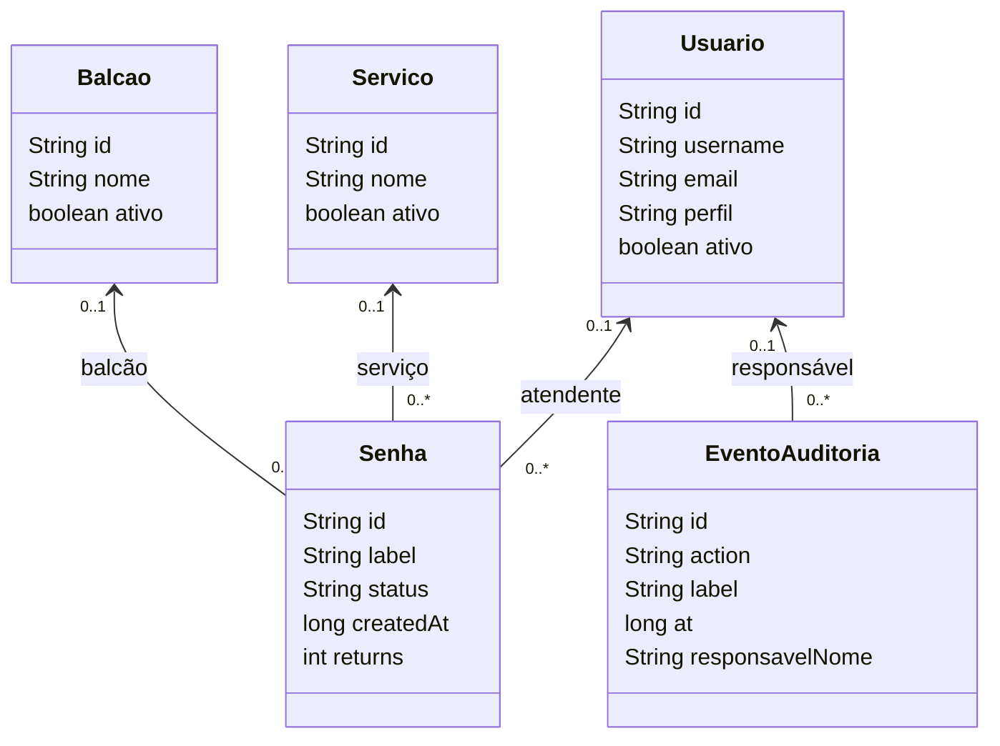

# Organização do código

O frontend usa Angular com NgModules, componentes `standalone: false` e Angular Material com tema cyan. As páginas são carregadas por rota. O backend usa Spring Boot, JPA e banco relacional.

| Pasta                       | Responsabilidade                                                                      |
| --------------------------- | ------------------------------------------------------------------------------------- |
| `src/app/core`              | Modelos, chamadas HTTP, estado da fila, catálogo, autenticação e guards               |
| `src/app/layout`            | Navegação e estrutura compartilhada das páginas                                       |
| `src/app/shared`            | MaterialModule e componentes reutilizáveis                                            |
| `src/app/features`          | Módulos de autenticação, recuperação, cadastros, funcionário, cliente, painel e totem |
| `backend/.../controladores` | Endpoints REST e validação dos pedidos                                                |
| `backend/.../servicos`      | Regras da fila, permissões, cadastros, auditoria e recuperação                        |
| `backend/.../repositorios`  | Acesso ao banco via Spring Data                                                       |
| `backend/.../entidades`     | Tabelas e relacionamentos JPA                                                         |
| `backend/.../dto`           | Contratos de entrada e saída da API                                                   |
| `backend/.../excecoes`      | Erros HTTP com mensagem padronizada                                                   |
| `backend/.../configuracoes` | Dados iniciais, importação e proteção da API                                          |

## Classes de negócio



As relações são `ManyToOne`. Campos de relacionamento são omitidos do JSON público para evitar exposição de dados e ciclos. O texto do serviço fica na senha como retrato histórico, mesmo quando o catálogo é renomeado. As colunas aceitam nulos para permitir atualização de bancos antigos; o inicializador tenta relacionar as senhas antigas pelo nome do serviço e pelo balcão disponível. Novas senhas sempre recebem serviço e balcão ativos.

`EstadoFila` guarda a sequência global, a ordem de espera e a pausa. `Aviso` é um valor embutido da senha, persistido em uma coleção separada. `RedefinicaoSenha` relaciona um usuário ao hash de um token, à expiração e ao estado de uso. Senhas de acesso ficam em BCrypt; o link original não é guardado no banco.

## Regras e comunicação

A interface usa REST em `/api`. Os eventos da fila chegam por SSE; há sincronização HTTP quando a conexão falha. Operações da fila usam transação e bloqueio pessimista de `EstadoFila`, preservando numeração e ordem em chamadas simultâneas. O evento é transmitido após a transação confirmar. A redefinição bloqueia o token no banco para impedir uso simultâneo.

A sessão fica no servidor e usa cookie HttpOnly, SameSite Strict. O backend consulta usuário, perfil, situação e versão da sessão em cada ação protegida. Alterar senha aumenta a versão e invalida sessões anteriores. O filtro verifica a origem dos pedidos de escrita e limita tentativas. Cadastros têm validação Angular e Bean Validation, além das regras de unicidade e integridade do banco. Erros de negócio retornam `{ "message": "..." }` com status HTTP adequado.

O administrador mantém os cadastros; o atendente opera a fila. O acesso público acompanha apenas a senha cujo token possui. A auditoria guarda ação, identificação do registro, data e responsável. Em emissão/retorno públicos, o responsável é Cliente / Totem; eventos de contas autenticadas guardam o usuário. Não registra senhas nem tokens de recuperação.

## Acrescentar um módulo

Execute na raiz:

```sh
npx ng generate module features/nome --routing
npx ng generate component features/nome --standalone=false --module=features/nome
```

Declare a rota filha no módulo gerado e adicione um `loadChildren` em `app.module.ts`. Use `authGuard` para páginas de funcionários e `adminGuard` para administração. Importe `SharedModule` e `ReactiveFormsModule` quando necessário. Serviços compartilhados vão em `core/services`; regras de negócio continuam no backend. Uma tela escondida no menu não substitui a autorização de seu endpoint.

## Situação dos requisitos

| Requisito das imagens                | Implementação                                                                                          |
| ------------------------------------ | ------------------------------------------------------------------------------------------------------ |
| Responsividade                       | Layout adaptável e tabela com rolagem local; validação em viewports de computador, tablet e celular    |
| Autenticação e recuperação           | Conta persistente, sessão, reset com expiração e uso único; SMTP depende da configuração da instalação |
| Dois perfis                          | ADMIN e ATENDENTE com autorização na API e nas rotas                                                   |
| CRUD e quatro entidades relacionadas | Usuário, Serviço, Balcão e Senha; histórico protegido por regras e chaves estrangeiras                 |
| Pesquisa, filtros e paginação        | Cadastros por nome/situação; senhas por número/serviço/status; página e tamanho validados              |
| Pelo menos três KPIs                 | Aguardando, concluídos hoje, tempo médio e ausentes                                                    |
| Fluxo pela interface                 | Emissão, acompanhamento, chamada, chegada, conclusão, ausência e retorno                               |
| REST e banco relacional              | Spring MVC, JPA, H2 persistente ou MySQL                                                               |
| Validação e erros                    | Formulários, Bean Validation, regras de serviço e mensagens HTTP padronizadas                          |
| Auditoria                            | Data, ação e usuário responsável; histórico visível na operação                                        |
| Testes de negócio                    | Fila, avisos, concorrência, perfis, CRUD, vínculos e recuperação                                       |
| Git e documentação                   | Repositório GitHub, este diagrama e manual separado; README vazio                                      |
| Publicação cloud                     | Dockerfile preparado; falta ativar hospedagem com persistência e validar a URL pública                 |

A implantação real, o envio SMTP real e os equipamentos físicos dependem do ambiente de uso. A execução local automatizada não confirma esses três pontos.
